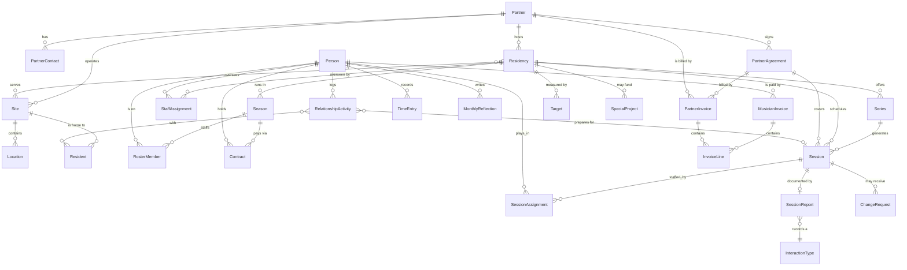

# Iris App — Domain Model (Language 1: the code)

_Draft v0.33, November 22, 2026 (v0.33: admins merge two people into one. v0.32: admins change anyone's email, with safeguards against typos. v0.31: a point person who also plays in their program may approve their own hours. v0.30: admins add people without inviting them, and set up people, buildings, programs, rosters and weekly programs from one spreadsheet. v0.29: approved weeks are final; approval waits until the week's programs are documented. v0.28: answers to Ryan's nine scheduling questions; permissions table brought up to date. v0.27: roster musicians' phone and instruments shown to the program's people. v0.26: community contacts per building built; staff phone and email on program pages and a staff directory on Home; links on Home. v0.25: answers to the schema review: subs, leaders, locked after review, history after a season. v0.24: shared relationship-building logs; the documented building; pay only for documented hours; deadline reminders and No Program emails through one outbox; Follow-up page with missing work and metrics; staff roles. v0.23: overhead switched on or off on the contract; stipend lines can be left off each month; custom invoices typed by hand. v0.22: community invoices built; billable hours are now per musician and count once the point person approves the week (revises D9); drafts live, sent invoices frozen; admins only. v0.21: less double entry for musicians: usual type per program, usual relationship-building lengths, "Same as last time", one "Submit my week"; detailed one-to-one notes and a daily Word document per site. v0.20: program length set once by the point person or an admin; leaders change it only if a session ran longer or shorter. v0.19: musician hours and invoices built: hours entered on My week, the point person approves, admins set rates and stipends, invoices per two-week pay period; "Collab?" is Yes/No and every Yes counts as co-led; the collaboration target is set per season by the point person or an admin. v0.18: roles narrowed: the point person plans, the Admin Lead publishes and updates published dates, musicians edit drafts they play in and pick leaders; monthly programs. v0.17: "No Program" dates can be restored. v0.16: season view for the point person. v0.15: usual leaders, season reminders, private calendar links. v0.14: documentation from the CESLC workbook sample, weekly; musicians write draft notes; schedule laid out like the workbook tab. v0.13: people in a program can see each other's names, nothing else. v0.12: every roster musician edits draft titles, rooms and musicians; the point person assigns leaders. v0.11: `Partner`, `Site`, `Location` built; see section 1. v0.10: scheduled relationship building (e.g. Lessons) and the partner calendar layout; v0.9: partner permission for resident names confirmed; v0.8: decisions D14 and D15 settled: residents and attendance; v0.7: decisions D10, D11 and D16 settled: events, extras, absences, substitutes and the roster; v0.6: both D9 billing details confirmed; v0.5: decisions D9 and D13 settled: partner billing and version 1 scope; v0.4: decisions D2, D4, D6, D7 and D8 settled; v0.3: decisions D1, D3 and D5 settled, including how a month's schedule is reviewed, published and sent; v0.2: `Person` rules confirmed and built; see section 7). This is the **authoritative** definition of the
app's objects. GLOSSARY.md translates the team's language (Language 2) and
our partner-facing language (Language 3) into these objects._

## The three languages

| | Language | Who uses it | Can it change? | Rule |
|---|---|---|---|---|
| **1** | **Domain model** (this file) | The code, the database, developers | Yes: we design it | One name, one meaning. No overloading, ever. |
| **2** | **Team language** | Iris staff and musicians, day to day | No: it is set | The app's screens may *display* team words, but every team word must map to exactly one object **in context** (GLOSSARY Part A). |
| **3** | **Outward language** | Partners, residents, funders: calendars, invoices, reports | No: it is set | Generated documents use partner-facing words and names. Templates map each printed field to an object attribute (GLOSSARY Part B). |

**Rules for Language 1**
1. **The word "program" is never used as an identifier** in code, database
   tables, columns or APIs. It is a display word only (Languages 2 and 3).
   Likewise "community" and "residency" (except `Residency`, defined
   below with one meaning) are not used loosely.
2. Every object below has one definition. If a new concept doesn't fit an
   existing definition, it becomes a new object. We don't stretch an old one.
3. Lists that people edit (types, categories) are **data**, not code, and are
   **versioned**: values are retired, never deleted, so old records keep their
   meaning.
4. Where a decision in TERMINOLOGY-REVIEW.md is still open, the model takes a
   default, marked **Assumption (D#)**. Changing an assumption changes this
   file first.

---

## Object map

---

## 1. Partners and places

### `Partner`
The organization Iris contracts with and bills (e.g. Charles E. Smith Life
Communities; Comprehensive Housing Assistance; Mather; Winter Growth; Asbury
Methodist Village). Also covers non-senior-living partners (a community
center, a 50+ center).

| Attribute | Type | Notes |
|---|---|---|
| `legal_name` | text | As on contracts and invoices |
| `display_name` | text | As printed on calendars (Language 3) |
| `billing_address`, `billing_email` | text | For `PartnerInvoice` |
| `active` | bool | |

### `Site`
A building or campus where programming happens (e.g. Ring House, Weinberg
Manors, Mather Tysons, Winter Growth Olney). Belongs to exactly one `Partner`.

| Attribute | Type | Notes |
|---|---|---|
| `partner_id` | → Partner | Required |
| `name`, `display_name` | text | |
| `care_levels` | set of enum | `independent`, `assisted`, `memory_care`, `skilled_nursing`, `adult_day`, `affordable_housing`, `other` |
| `address`, `city`, `state`, `timezone` | text | Timezone matters: sites span ET, CT and MST (Tucson) |
| `active` | bool | |
| `detailed_relationship_notes` | bool | **v0.21 (Lauren, Nov 22, 2026):** the partner wants a written note on each one-to-one. Admins switch it on per site. There, a `RelationshipActivity.note` can be a paragraph (up to 3,000 characters), and a **daily Word document** of that site's relationship building can be downloaded: musicians get their own visits, the point person and admins get everyone's. Still no health information |

**Multi-building partners (decided by Ryan, Nov 2026).** There is no object between `Partner` and `Site`. A partner with several buildings, such as CESLC, is one `Partner` with one `Site` per building that has its own care level or calendar (independent living, assisted living, memory care…). How near the buildings are to each other (walking distance, a short drive, farther) is not stored; each `Site` has an address and time zone, and distance can be derived later if pay or scheduling needs it. A `Residency` may span several `Site`s.

**Built (Nov 2026):** `Partner`, `Site` and `Location` are retired (`active = false`), never deleted. `Site.timezone` must be a real time zone. Names are unique within their parent. A `Site` can't move to another `Partner`, and a `Location` can't move to another `Site`. `Partner.billing_address` and `billing_email` are optional; invoices go one per contract, per site, per month (D4).

Partners vary: one building with a single care level is one `Site`; a building shared by two care levels is one `Site` with both `care_levels`.

### `Location`
A specific room, unit or floor within a `Site` (an auditorium, a named
building on a campus, a unit). Belongs to exactly one `Site`.

| Attribute | Type | Notes |
|---|---|---|
| `site_id` | → Site | Required |
| `name`, `display_name` | text | |
| `active` | bool | |

### `PartnerContact`
A person at a partner who receives calendars or invoices. Does **not** sign in.

| Attribute | Type | Notes |
|---|---|---|
| `partner_id` | → Partner | |
| `site_ids` | → Site (many) | Which sites they cover; empty = all |
| `name`, `title`, `email`, `phone` | text | |
| `receives` | set of enum | `calendar`, `invoice` |

**Built (v0.26, Lauren, Nov 22, 2026):** shown under each building on the
program page. The program's point person or an admin adds, changes or
removes them (removed contacts are retired, never deleted); that program's
people (roster, point person, admins) see them. `receives` isn't used yet.

### `Resident`
An older adult at a `Site` with whom musicians build relationships. Minimal
by design. **Never** holds health information.

| Attribute | Type | Notes |
|---|---|---|
| `site_id` | → Site | Required. A resident belongs to one site |
| `display_name` | text | **First name + last initial** (e.g. "Ruth K."), as musicians know them (D14) |
| `disambiguator` | text | Optional short note to tell residents with the same name apart (e.g. unit or "violin student"). **No health details** |
| `active` | bool | Deactivate when a resident moves or passes away; never delete (history) |

**Invariant:** `display_name` + `disambiguator` is unique within a `Site`.

**Decided (D14, Nov 21, 2026)**
- **No preloaded list.** The resident list for a site is built by
  musicians as they work: when logging a `RelationshipActivity`, a musician
  picks a resident already on the site's list or adds a new one (first name
  + last initial, plus a disambiguator if the name is taken).
- **Who can see a site's residents:** musicians on the current roster of a
  residency serving that site (including subs who joined it, D16), that
  residency's point person, and admins. **Every view is logged**
  (`AuditLog`).
- **Hebrew Home** keeps its own "Bedside Melodies" workbook, which the
  partner's team also edits. Musicians there log relationship building in
  **both** places; the app doesn't import or sync the workbook.
- **Partner permission (REQUIREMENTS Q1), confirmed by Lauren, Nov 21,
  2026:** partners are comfortable with Iris recording residents this way,
  because only minimal information is kept and none of it is shared. If a
  partner later asks for a confidentiality agreement or BAA, revisit
  REQUIREMENTS Q8 (hosting).

---

## 2. Residencies, seasons and people

### `Residency`
**Iris's ongoing engagement with one Partner at one or more of its Sites,
delivered by a roster of musicians.** This is what the team calls "the
program at Mather" (Language 2) and what the workbooks call an "Iris Ensemble
Program". The code uses `Residency` because the team no longer uses that word
day to day, so it carries exactly one meaning here, and it names the
Ensemble-in-Residence model. **Decided (D1, Nov 21, 2026):** the code name
is `Residency`; screens and documents still say "program".

| Attribute | Type | Notes |
|---|---|---|
| `partner_id` | → Partner | Required, exactly one |
| `site_ids` | → Site (many, ≥1) | All must belong to `partner_id` |
| `name` | text | Internal, e.g. "Mather Evanston/Wilmette" |
| `display_name` | text | For outward documents, e.g. "Iris Music Project at Ring House" |
| `status` | enum | `planned`, `active`, `paused`, `ended` |
| `started_on`, `ended_on` | date | |

**Invariants:** a `Residency` belongs to one `Partner`. Each `Site` may host
several residencies over time, but they don't overlap within the same
`Season` dates unless an admin allows it.

### `Season`
A dated period of a `Residency` during which a roster, contracts, targets
and stipend installments apply (e.g. "Asbury Feb–May 2027", "Weinberg Manors
Fall 2026").

| Attribute | Type | Notes |
|---|---|---|
| `residency_id` | → Residency | |
| `name` | text | |
| `starts_on`, `ends_on` | date | |
| `kind` | enum | `semester`, `season`, `summer_session`, `other` |

**Decided (D8, Nov 21, 2026):** seasons are set **per residency**, with
each residency's own dates. A semester is a `Season` with `kind = semester`;
"twice per semester" stipends and per-semester targets attach to `Season`.

### `Person`
Anyone who signs in: musicians, staff, volunteers. One record per human.

| Attribute | Type | Notes |
|---|---|---|
| `name`, `email` (login), `phone` | text | Email is the sign-in identity (Supabase) |
| `employment_type` | enum | `contractor_1099`, `employee_w2`, `volunteer` |
| `instruments` | set of text | |
| `system_roles` | set of enum | `admin` (see section 7): the Iris core (salaried) team, who get the admin view across every residency (D5). Empty for most musicians |
| `job_title` | text | Org-chart title, e.g. "Director of Programs", "Musician in Residence 1". **Display only. Grants no permissions** |
| `active` | bool | Deactivated people keep history and cannot sign in |
| `certified_on` | date | Creative Aging Practitioner certification, if completed |
| `invited_at` | datetime | **v0.30 (Lauren, Nov 22, 2026):** when the sign-in invite was last sent. Empty = an admin added them without inviting them yet (e.g. to set up rosters and schedules before roll-out). They can't sign in until invited; "Send invite" emails a link to set a password, and "Email me a code instead" also works once invited. Email is still required when adding; last name, phone and the rest are optional |

**Rules (confirmed by Ryan, Nov 21, 2026; built in `supabase/migrations`):**
- People are **deactivated, never deleted**. Deactivating blocks sign-in and hides all data from that person at once (R9.5).
- A person may change only their own `phone` and `instruments`. Everything else is admin-only.
- `email` is the sign-in identity. **v0.32 (Lauren, Nov 22, 2026):** an admin
  can change it at any time (a typo in the import, or someone asking for a new
  address), with **Change email** on the person's page. Safeguards against
  typos: the new address is typed twice (no pasting into the second box),
  likely domain typos are flagged ("did you mean …@gmail.com?"), and the
  change is confirmed with the old and new address side by side. It changes
  the sign-in account and the record together; any link already sent to the
  old address stops working. Not signed in yet: `invited_at` is cleared so the
  invite goes to the new address. Already signed in: same password, and a
  notice goes to both addresses. Nobody changes an email straight from the
  browser; the database refuses it.
- **Merging two people (v0.33, Lauren, Nov 22, 2026):** for when the same
  person has two records (a wrong email in the import, or a new address set up
  as a new person). Admins only, on the kept person's page. Everything from
  the other record moves to the kept one: roster places, staff roles (point
  person), usual programs, dates, documentation, relationship building,
  residents they added, hours, pay rates, reflections and calendars. Empty
  details are filled from the other record; instruments and roles are
  combined. The admin picks which **email** the person signs in with. If
  either had signed in before, both old passwords stop working, they're
  signed out, and a link to set a new password goes to the kept email. Both
  having hours for the same week, a pay rate for the same season or a
  reflection for the same month should never happen; if it does, the merge
  stops and says where. The other record and its sign-in account are
  **deleted** (Lauren's choice; an exception to "retired, never deleted").
  An admin can't merge themselves away. All or nothing.
- An admin can't remove their own `admin` role or deactivate themselves, so Iris can't be locked out by accident.

### `RosterMember`
A `Person`'s membership on a `Residency` for one `Season`. **Decided (D16,
Nov 21, 2026):** the roster is everyone who plays at the residency that
season: the core ensemble (`is_core`) and everyone else, including
substitutes. A substitute who isn't on the roster **joins it as a non-core
member** when they're named as a sub, so they see the residency's sessions
and residents like other roster members.

| Attribute | Type | Notes |
|---|---|---|
| `season_id` | → Season | |
| `person_id` | → Person | |
| `is_core` | bool | Part of the core ensemble ("the ensemble", "the Trio") vs. occasional players and substitutes (D16) |
| `is_admin_lead` | bool | The handbook's "administrative project lead". **At most one per Season**, covering all of the residency's sites (D5) |
| `joined_on`, `left_on` | date | |

**Phone and instruments (v0.27, Lauren, Nov 22, 2026):** the program's
people (its roster, point person and admins) see each roster musician's
phone and instruments (from `Person`, kept up to date on My profile) on the
season roster. Email stays private. This widens v0.13 (names only) for
these two fields, within one program.

**Substitutes (v0.25, Lauren, Nov 22, 2026):** a sub is a roster musician
like any other: they see the program's schedule and edit only the draft
dates they play in. No extra limits.

**After a season ends (v0.25, Lauren, Nov 22, 2026):** musicians keep
**read-only** access to their own history for that season (schedule,
documentation, relationship building, hours, invoices) for as long as they
stay active, so returning musicians can look back. They see resident names
only in records they wrote or shared, not the program's resident list or
other musicians' logs. They can't change or submit anything for an ended
season; the point person or an admin finishes any open week (including
submitting it on the musician's behalf). Access ends when an admin
deactivates the person (or removes them from the roster).

### `StaffAssignment`
An Iris staff member responsible for a `Residency` (the handbook's
"designated Iris staff member"; the team says "point person").

| Attribute | Type | Notes |
|---|---|---|
| `residency_id` | → Residency | |
| `person_id` | → Person | Must have `system_roles ∋ admin` or be explicitly granted |
| `role` | enum | `point_person` (approves), `support` (view only) |
| `starts_on`, `ends_on` | date | Effective dating keeps history through org changes (2028, 2029) |

**Invariant:** each active `Residency` has exactly one current
`point_person`.

### `Contract`
The agreement under which Iris pays a contractor for one `Season` of one
`Residency`. **Decided (D9, Nov 21, 2026):** the hourly rate lives on each
contract, so a musician working in two regions can have two rates.

| Attribute | Type | Notes |
|---|---|---|
| `person_id`, `season_id` | → | Unique together |
| `hourly_rate` | money | Flat rate, prep time included |
| `estimated_weekly_hours` | number | |
| `stipends` | list of `StipendInstallment {kind, due_on, amount}` | `kind`: `project_support`, `admin_lead`, `training`, `other`. Built v0.19 as one row per payment |
| `signed_on` | date | |
| `status` | enum | `draft`, `sent`, `signed`, `ended` |

W-2 employees have no `Contract`. They are paid through payroll.

**Built (v0.19, decided by Lauren Nov 22, 2026):** admins set each
contractor's hourly rate and stipend payments on the program page, per
season. Only the musician and admins can see a contract; **the point person
never sees pay.** `signed_on` and `status` are not built yet.

---

## 3. Scheduling

### `InteractionType`
The admin-managed, versioned list of kinds of group session, chosen **only
when documenting** a session (`SessionReport`), not when scheduling it.

**Decided (D2, Nov 21, 2026):** the starting list is the 2026 documentation
pages' list, kept for organization-wide stats and evaluation:

| Starting value | `model_type` |
|---|---|
| Music Instructional Program | `small_group` |
| Lecture/Discussion | `small_group` |
| Interdisciplinary Program | `small_group` |
| Open Rehearsal | `performance` |
| Performance | `performance` |
| Other | set by an admin |

One-to-ones, mini-group sessions and resident co-facilitation are **not**
interaction types. One-to-ones and mini-groups are `RelationshipActivity`
records; co-facilitation is `SessionReport.resident_involvement` (D6).
Pay categories are a separate list (`TimeCategory`).

| Attribute | Type | Notes |
|---|---|---|
| `name` | text | |
| `model_type` | enum `ModelType` | `performance`, `small_group`, `one_to_one`. Maps to the JAAH model's three types |
| `default_time_category` | → TimeCategory | Used to pre-fill time entries |
| `active` | bool | Retired, never deleted |
| `description` | text | Shown to musicians as guidance |

### `Series`
**A titled, recurring offering within a `Residency`** (Language 2: "the
Music Café program", "Tuesday open rehearsals"). A `Series` is a template;
it doesn't happen. Its `Session`s happen.

| Attribute | Type | Notes |
|---|---|---|
| `residency_id` | → Residency | |
| `kind` | enum `SessionKind` | `group_session` (default) or `relationship_building` (e.g. "Lessons"). See below |
| `title` | text | **Title only.** Never personnel or location (D12) |
| `default_location_id` | → Location | Must be at one of the residency's sites |
| `recurrence` | rule | **Weekly** on chosen weekdays (e.g. Wednesdays 11:00, 120 minutes), or **monthly** on the 1st–4th of one weekday (`week_of_month`, e.g. the 4th Monday at 1:30; v0.18). Monthly programs print under Regular programming. Time and length are **optional** for `relationship_building` |
| `default_personnel` | → Person (many) | Must be on the current roster |
| `default_leader_id` | → Person | Optional **usual leader** (v0.15): made leader on every date when a month is filled in. Weekly programs without one are left for the point person |
| `default_interaction_type_id` | → InteractionType | Optional **usual type** (v0.21, Lauren, Nov 22, 2026), set by the point person or an admin. Pre-selected when the leader documents; the leader can change it, so the type is still chosen when documenting (D2) |
| `active_from`, `active_until` | date | |

### `Session`
**One scheduled occurrence on a specific date and time.** The unit of
scheduling, partner calendars, documentation and partner billing. A session
either comes from a `Series` or stands alone (a special event, a concert,
an extra program).

| Attribute | Type | Notes |
|---|---|---|
| `residency_id` | → Residency | Required |
| `series_id` | → Series | Optional. Null = one-time session |
| `kind` | enum `SessionKind` | Copied from the series. `group_session` or `relationship_building` |
| `title` | text | Copied from the series and editable per session |
| `location_id` | → Location | |
| `starts_at` | datetime (site timezone) | The date, and the time when there is one |
| `has_set_time` | bool | False for a `relationship_building` session with no set time: it prints with a blank time |
| `scheduled_minutes` | int | Optional for `relationship_building`. Copied from `Series.minutes`; **v0.20:** changing the series length updates every date not yet documented (past or future, not canceled) |
| `call_time` | time | Optional (concerts) |
| `is_special_event` | bool | Shown in the "Special events" section of partner calendars. Concerts are special events (D10) |
| `is_extra` | bool | An "extra program": outside contracted hours, separately negotiated pay, and musicians may decline. **Billed to the partner like any session (D10)** |
| `billable` | bool | Default true. An admin can set it false for a session Iris doesn't bill (e.g. a gift to the community) (D10) |
| `special_project_id` | → SpecialProject | Optional |
| `partner_agreement_id` | → PartnerAgreement | The contract the session falls under. Defaults to the residency's only agreement for the season; required when there are several (D4) |
| `schedule_state` | enum | `draft`, `published`, `canceled` |
| `cancellation_reason` | enum | `partner`, `weather`, `musician`, `other`. Required if canceled |
| `canceled_at` | datetime | When the cancellation was recorded. Compared with `Setting.cancellation_notice_time` to tell a late partner cancellation (D9) |
| `public_note` | text | May print on partner calendars |
| `internal_note` | text | Never prints |

**Scheduled relationship building (decided Nov 21, 2026).** Some weekly
offerings are relationship building, not group sessions: e.g. "Lessons with
[musicians]" on Tuesdays, often without a set time. They're a `Series` with
`kind = relationship_building`, set up once and filled in each month like
any other weekly program, and they print on the partner calendar (blank
time if none). They're **documented as `RelationshipActivity` records**
(linked through `RelationshipActivity.session_id`), not by a
`SessionReport`; they need no leader, and their hours come only from those
logged activities, so nothing is counted twice. Unscheduled relationship
building (one-to-ones that happen organically) never prints (D2).

**Invariants**
- `location.site` ∈ `residency.sites`.
- A non-canceled `group_session` has **exactly one** playing
  `SessionAssignment` with `role = leader`. `relationship_building`
  sessions need none.
- Once `published`, only admins, the point person and the Admin Lead can
  edit it. Every edit is logged in `AuditLog`, and the session's musicians
  are notified. Others submit a `ChangeRequest`. (D5) Exception: a musician
  assigned to the session can mark themselves absent and name their sub (D11).
- A canceled session stays in the record. Musicians aren't paid for it
  (handbook). Partner billing follows `PartnerAgreement.bill_canceled`.
- **Restoring a "No Program" date (v0.17, decided by Lauren Nov 22, 2026).**
  Calendars take back-and-forth (e.g. a musician marks a date "No Program",
  then the point person asks for a sub instead). The Admin Lead, point person
  or an admin can restore it: it comes back as a **draft** with its
  musicians and leader, its cancellation reason cleared, and the change
  logged. It's published with its month, or with the next calendar version
  if the month was already sent.
- **Planned absences (D11).** When a musician's absence is known before the
  10th (`Setting.schedule_internal_due_day`) and no sub is arranged, the
  Admin Lead cancels that session in the draft with `cancellation_reason =
  musician`. The partner calendar prints that slot as **"No Program"**.

### `SessionAssignment`
A `Person` assigned to play in a `Session`.

| Attribute | Type | Notes |
|---|---|---|
| `session_id`, `person_id` | → | Unique together |
| `role` | enum | `leader`, `participant` |
| `status` | enum | `assigned`, `absent`, `substitute` |
| `substitute_for_id` | → Person | Required when `status = substitute` |

The program leader is **per session** and is expected to rotate among
participating musicians (handbook). The app can report rotation balance.

**Absences and substitutes (decided, D11 and D16, Nov 21, 2026)**
- Subs are rare. The musician arranges their own sub (handbook), then
  **records it in the app themselves** on their published session: their
  assignment becomes `absent`, and a new assignment with `status =
  substitute` and `substitute_for_id` = the absent musician is added.
- The sub can be **any active `Person`**. If the sub isn't on the
  season's roster, they're added as a non-core `RosterMember`. Someone
  outside the Iris network must first be added as a `Person` by an admin.
- The change is logged, and the Admin Lead and point person are notified.
- Each musician's missed sessions this season are counted; when the count
  passes `Setting.max_musician_absences_per_season`, the Admin Lead and
  point person get a warning.
- If the absent musician was the session's leader, the sub or another
  participant must become leader (a session keeps exactly one leader).

### `ChangeRequest`
A request to change a published `Session`.

| Attribute | Type | Notes |
|---|---|---|
| `session_id`, `requested_by` | → | |
| `proposed_changes` | structured | Any of title, time, location, personnel, cancellation |
| `reason` | text | |
| `status` | enum | `open`, `approved`, `declined` |
| `decided_by`, `decided_at` | | |

### `Closure`
Dates when sessions don't run (Iris holidays, partner closures, blackout
dates). Musicians' blackout dates (`scope = person`) are **in version 1
(D13)** and show when scheduling.

| Attribute | Type | Notes |
|---|---|---|
| `scope` | enum + id | `all_iris`, `partner`, `site`, `residency`, `person` (a musician's blackout dates) |
| `starts_on`, `ends_on` | date | |
| `reason` | text | |

### `CalendarFeed`
A musician's **private calendar link** (v0.15, decided by Lauren Nov 22,
2026). Google, Apple and Outlook calendars subscribe to it and refresh on
their own.

| Attribute | Type | Notes |
|---|---|---|
| `person_id` | → Person | One link per person |
| `token` | text | Secret. The person can replace it ("Make a new link"), which stops the old one |

**Shows:** published (and canceled, as "No Program") sessions the person
plays in (not absent), plus special events of programs they're on; from 60
days ago to a year ahead. Drafts never appear. **Security review pending
(Ryan's side):** the feed is readable by anyone holding the link.

**Season view (v0.16, decided by Lauren Nov 22, 2026).** The point person
(and Admin Lead, admins) sees a whole `Season` at once: each weekly
program's **leader for the whole season** (setting it makes them the usual
leader and the leader of every draft date from today on; published months
don't change), month-by-month status (published, drafts, "No Program",
dates still needing a leader), and **Fill the whole season**. Some weekly
programs have one leader all season (e.g. Orchestra); others are picked per
date.

**Season reminders (v0.15).** Each month's schedule shows a "Coming up this
season" box: the program's special events in later months (often planned
at the start of a season), so musicians see them every month until they
happen.

### `CalendarExport`
One version of a monthly partner calendar for one site (Language 3
document). A month can have several versions as the partner gives feedback.

| Attribute | Type | Notes |
|---|---|---|
| `residency_id`, `site_id` | → | |
| `month` | year-month | |
| `version` | int | 1, 2, 3… per residency × site × month. Unique together |
| `state` | enum | `reviewed` (version 1 only: reviewed, not yet published), `sent` |
| `reviewed_by`, `reviewed_at` | → Person, datetime | Version 1 only: the point person (or an admin) after reviewing the draft with the Admin Lead |
| `format` | enum | `pdf`, `docx` |
| `generated_at`, `generated_by` | | Who clicked "Publish and download" (version 1) or "Download updated calendar" (later versions) |
| `sent_at` | datetime | Set when generated. The Admin Lead emails the file from their own email, cc'ing the point person; the app doesn't send it |
| `partner_feedback` | text | Optional. A summary of the partner's reply that led to the next version. **Internal: never prints** |
| `file` | storage ref | |

Built only from `published` sessions.

**Who does what (v0.18, decided by Lauren Nov 22, 2026; supersedes the
drafting rules below where they differ)**

| Who | Can do |
|---|---|
| **Point person, admins** | Everything: set up weekly and monthly programs (in the season view), fill months and the season, add events, set leaders, "No Program" and restore, mark a month reviewed |
| **Admin Lead** | Publish and download; update **published** dates after the partner's staff asks (time, room, title, notes, **who plays and the leader**, "No Program" or restore) and download the updated calendar; add one-time events (the point person staffs them, v0.28); make **any draft date** in their program "No Program" (v0.28). Not: fill months or the season, set up programs |
| **Every roster musician** (Admin Lead included) | On **draft dates they play in**, **until the point person marks the month reviewed**: title, notes, room, who plays, and **swap the leader** (only once the point person has set one; a date with no leader waits for the point person, v0.25); date and time of special events they play in; **make it "No Program"** (v0.28; restoring stays with the point person and Admin Lead). They can't add themselves to a one-time event nobody is on yet |

**Scheduling answers (v0.28, Lauren, Nov 22, 2026; Ryan's questions Q1–Q9):**
- **Leaders:** a musician can't name a leader where none is set (Q1, as v0.25).
- **Empty one-time events:** the point person (or an admin) puts the first musicians on them; no sign-up (Q2).
- **"No Program" on drafts:** any musician playing the date, or the Admin Lead on any draft date in their program, until the month is reviewed. The point person is emailed every time (`Notification`, v0.24) (Q3).
- **Published dates:** the Admin Lead (and the point person) can change who plays and swap the leader. A swap is **one step**, so a date is never without a leader (Q4, Q7).
- **Calendar links** show a month only once it's published; a draft date made "No Program" stays hidden too (Q5).
- **Change history:** removing a musician from a draft date doesn't need recording (Q6).
- **Deactivated people** can't be put on a date or made leader, and a month can't publish with one on it; the app names who to replace (Q9).

**Locked after review (v0.25, Lauren, Nov 22, 2026):** once the point person
marks a month reviewed, its drafts are locked for musicians; only the
point person and admins change them, and the Admin Lead publishes.
Musicians ask the point person for changes.

**Publishing a month (decided, D5, Nov 21, 2026; drafting updated Nov 22)**

Roles: the **point person** is Iris staff (`StaffAssignment`); the **Admin
Lead** is the roster musician leading the project, still an independent
contractor (`RosterMember.is_admin_lead`).

1. **Auto-fill.** Weekly programs (`Series`) fill in the month's draft
   sessions with their dates, times, rooms and default musicians, all
   weekly programs at once, so nothing is re-entered month to month.
   The Admin Lead (or point person, or an admin) adds one-time sessions
   and special events.
2. **Musicians edit the draft.** Every musician on the residency's current
   roster can edit any draft session in that residency: its **title**
   (each date has its own, e.g. this week's theme), **internal notes**
   (e.g. "Ben off", never printed; v0.14), **room**, and **who plays**
   (adding or removing roster musicians as participants). Titles are typed
   without musicians' names; the calendar adds "with [first names]" (D12).
   The schedule screen is laid out like the workbook scheduling tab: Day,
   Time, Program Title, Program Leader, Notes. Titles lock when the month is
   published (decided Nov 22, 2026). For **special events** they can also change the **date
   and time**. They can't set leaders, cancel, or change anything else.
   **Assumption:** creating new special events stays with the Admin Lead,
   point person and admins.
3. **Leaders, then review.** The point person assigns each group session's
   leader, then reviews the draft with the Admin Lead (often on a call) and
   marks it reviewed. This creates version 1 with `state = reviewed`.
   Afterwards the Admin Lead can swap a leader if needed (e.g. after a
   sub); admins always can.
3. The Admin Lead clicks **Publish and download**. All of that site's draft
   sessions for the month become `published`, the PDF is generated, and
   version 1 becomes `sent`. **Musicians treat the schedule as final from
   here.** Version 1 can't be generated before step 2.
4. The Admin Lead emails the PDF to the partner from their own email, with
   the point person cc'd.
5. If the partner sends feedback, the Admin Lead edits the published
   sessions (each change logged; musicians notified), optionally records
   `partner_feedback`, and clicks **Download updated calendar**, which
   creates the next version with `state = sent`. Later versions don't need
   another review.

---

## 4. Documentation

### `SessionReport`
The documentation of one `Session`, written by its **leader**. **Decided (D3):** other musicians at the session don't document it; each logs their own `RelationshipActivity`, `TimeEntry` and `MonthlyReflection`.

| Attribute | Type | Notes |
|---|---|---|
| `session_id` | → Session | One report per session |
| `author_id` | → Person | The session leader (or an admin) |
| `site_id` | → Site | **v0.24 (Lauren, Nov 22, 2026):** the building the program happened in, picked from the program's buildings when documenting; starts as the scheduled room's building. Attendance metrics and community invoices use it |
| `actual_minutes` | int | Length; used for billable session hours (D9). **v0.20 (Lauren, Nov 22, 2026):** the leader doesn't type it; it is `scheduled_minutes` unless they choose "Ran longer or shorter?". An in-app timer may come later |
| `attendance` | int | **Everyone present**: residents, staff, family and guests, counted together (D15) |
| `interaction_type_id` | → InteractionType | Chosen by the leader when documenting (D2) |
| `resident_involvement` | enum `ResidentInvolvement` | `none`, `co_facilitated`, `co_led`. What actually happened. **Revised v0.19 (Lauren, Nov 22, 2026):** the leader answers "Collab?" Yes or No only; **Yes is stored as `co_led`** and every Yes counts as collaborative and toward the season's target. `co_facilitated` is kept for older records but no longer offered |
| `notes` | text | No health information |
| `submitted_at` | datetime | |

Approval (`state`, `approved_by`, `approved_at`) comes later.

**Documented weekly (decided Nov 22, 2026).** Each musician has a **"My
week"** page (Monday–Sunday) showing the programs they led, their
relationship-building activities, and the month's reflection, due Tuesday
5 pm the following week (D7). The workbook's "Collab?" column is
`resident_involvement`: No / Yes (v0.19).

**Invariants:** exists only for sessions that are not canceled and are in
the past. Locked once `approved`; corrections go through an admin and are
logged.

**After submitting** (D2 follow-up), the musician sees where they and their
residency stand on this season's `Target`s (e.g. co-led sessions so far
this semester, average attendance). Interaction type and collaboration are
captured only here, never on the schedule.

### `RelationshipActivity`
One logged instance of relationship building with one or more residents
(Language 2: "relationship-building activity", formerly "one-to-one").
**Logged after it happens** (they're often organic and unscheduled), and
**never shown on partner calendars** (D2).

| Attribute | Type | Notes |
|---|---|---|
| `person_id` | → Person | The musician who logged it |
| `musicians` | → Person (many), via `RelationshipActivityMusician` | **v0.24 (Lauren, Nov 22, 2026):** other roster musicians who did it too, added by the one who logs it. Documented once (residents and note once); **each musician is credited the minutes, paid for them, and the partner is billed per musician.** An added musician can take themself off ("Not me") |
| `residency_id` | → Residency | |
| `site_id` | → Site | Required. One of the residency's sites; needed because relationship-building time is billed per site (D9) |
| `occurred_on` | date | |
| `location_id` | → Location | Optional; must be at `site_id` |
| `kind` | enum | `one_to_one`, `mini_group` (2–8 residents), `hallway_concert` (decided Nov 22, 2026) |
| `minutes` | int | **Required** (decided Nov 22, 2026): billed per site (D9) and pre-fills weekly hours |
| `collaborative` | bool | The workbook's "Collab?" (decided Nov 22, 2026) |
| `resident_ids` | → Resident (many) | All at `site_id`. At least one, except **Assumption:** a hallway concert may have none (played for whoever is there) |
| `session_id` | → Session | Optional: the scheduled `relationship_building` session it happened in. **Not asked on the form (v0.19, Lauren removed "part of a scheduled lesson")** |
| `prepares_session_id` | → Session | Optional: planning a co-led session (handbook: ≥5 meetings) |
| `note` | text | One sentence (500 characters), or a paragraph at a `Site` with `detailed_relationship_notes` (v0.21). **No health information** |
| `state` | enum | `submitted`, `approved` |

**Faster logging (v0.21):** Minutes are filled from the program's usual
length for the type (`ActivityLength`); after logging, the date, site and
type stay for the next visit; **Same as last time** copies the musician's
last activity (site, type, length, collaboration, residents).

### `ActivityLength`
The usual minutes for one kind of relationship building in one `Residency`
(v0.21, Lauren, Nov 22, 2026). Set by the point person or an admin on the
Season page; fills Minutes on the log form. Attributes: `residency_id`,
`kind` (`one_to_one`, `mini_group`, `hallway_concert`), `minutes`. Unique per
residency and kind.

### `EngagementType`
**Not in version 1** (decided Nov 22, 2026): the activity's `kind` is
enough for now. May return later as an admin-managed list.

### `MonthlyReflection`
A musician's monthly narrative for one `Residency`. **In version 1 (D13).**

| Attribute | Type | Notes |
|---|---|---|
| `person_id`, `residency_id`, `month` | | Unique together |
| `highlights` | text | "What am I most proud of this month?" |
| `challenges` | text | "What were my biggest barriers to success this month?" |
| `state` | enum | `draft`, `submitted` |

---

## 5. Time and pay

### `TimeCategory`
Admin-managed, versioned list of pay categories (Language 2: "Programs",
"Relationship Building", "Concerts"; possibly training/meetings).
Attributes: `name`, `description` (the handbook's definition), `paid_hourly`
(bool), `active`.

### `TimeEntry`
Hours a musician worked in one week, for one `Residency`, in one category.
**This is what pay is calculated from. Decided (D3, option A, Nov 21, 2026):** time entries are pre-filled from documented sessions and activities, and the musician adjusts them.

| Attribute | Type | Notes |
|---|---|---|
| `person_id`, `residency_id` | → | |
| `week_starting` | date (Monday) | |
| `time_category_id` | → TimeCategory | |
| `hours` | decimal | |
| `source` | enum | `prefilled` (from sessions and activities), `manual` |
| `state` | enum | `draft`, `submitted`, `approved` |

**Invariant:** unique per person × residency × week × category. The app
flags a week when submitted hours differ sharply from documented sessions
and activities (not built yet).

**Built (v0.19, decided by Lauren Nov 22, 2026):** musicians enter hours on
**My week**, pre-filled from the programs they played (Programs), special
events (Concerts) and logged relationship building, and submit them with
their documentation. The **point person approves** each musician's week for
their program, or sends it back with a note (`returned_note`). Approved
hours are locked. Admins can also approve.

**Submit my week (v0.21, Lauren, Nov 22, 2026):** one button submits the
week's hours for every program at once. The database refuses while a
program the musician led that week (and that has happened) has no
`SessionReport`.

**Pay only for documented hours (v0.24, Lauren, Nov 22, 2026; replaces the
"adjust them" part of D3):** musicians no longer type hours. A week's
hours are calculated from documentation: **Programs** = the documented
length of each program they played (not absent), **Concerts** = the same
for special events, **Relationship Building** = minutes of every log they
logged or were added to. Until the week is approved, pay changes by fixing the documentation. Approving a week refreshes its hours
from documentation first (keeping the original submission time).

**Approved weeks are final (v0.29, Ryan, Nov 22, 2026; M-Q2).**
- Until the point person approves a week, musicians can still fix that
  week's documentation after "Submit my week". Approval uses what's there at
  that moment.
- **A week is approved only when it's complete:** approval waits while a
  program the musician played that week has no `SessionReport` yet, and names
  the leader it's waiting for.
- **After approval,** that week's documentation is final: its
  `RelationshipActivity` logs (and who shares them), the `SessionReport`s of
  programs anyone with an approved week played, who played them, and their
  date, time, room, billable flag, length and "No Program" state. Titles and
  notes stay editable. A program's length is final once the first approved
  week includes it.
- **Corrections** after approval are made by an admin; every change is
  logged (`AuditLog`).
- On screen, an approved week reads as approved.
- **Later:** corrections recorded as an adjustment line in the next open pay
  period, so an approved week and its invoice never change.

### `PayPeriod`
A two-week, Monday–Sunday period. Attributes: `starts_on`, `ends_on`,
`pay_date`.

**Decided (v0.19, Lauren, Nov 22, 2026):** periods are counted every 14 days from the
`Setting` `pay_period_anchor` (Monday, November 2, 2026), not stored as rows.
`pay_date` is not built yet.

### `PayAdjustment`
A one-off payment outside hourly pay and stipends: special pay, an extra
program, a special project fee, a reimbursement.

| Attribute | Type | Notes |
|---|---|---|
| `person_id`, `residency_id` | → | |
| `kind` | enum | `special_pay`, `extra_program`, `special_project`, `reimbursement`, `other` |
| `amount` | money | |
| `session_id` / `special_project_id` | → | Optional link |
| `state` | enum | `proposed`, `approved` |

### `MusicianInvoice`
What Iris pays one contractor for one `PayPeriod` (Language 3: the musician's
invoice to Iris).

| Attribute | Type | Notes |
|---|---|---|
| `person_id`, `pay_period_id` | → | Unique together |
| `lines` | → InvoiceLine (many) | |
| `total` | money | Sum of lines |
| `state` | enum | `draft`, `approved`, `paid` |

**Calculation:** approved `TimeEntry` hours in the period × `Contract.hourly_rate`
(per residency), + stipend installments due in the period, + approved
`PayAdjustment`s. Only `employment_type = contractor_1099`.

**Built (v0.19):** "My invoices" shows each pay period's invoice, computed
live (not stored yet, so `state` isn't built), with a PDF billed to Iris
Music Project. `PayAdjustment`s are not included yet.

### `PartnerAgreement`
A contract under which Iris charges a `Partner` for services at one or more
`Site`s of a `Residency` in a `Season`. Usually one per residency season;
a site can have several (e.g. Hebrew Home has three contracts for different
services).

| Attribute | Type | Notes |
|---|---|---|
| `partner_id`, `residency_id`, `season_id` | → | |
| `site_ids` | → Site (many, ≥1) | Sites this contract covers; all in the residency |
| `name` | text | Internal, e.g. which service it covers |
| `billing_basis` | enum | `per_hour` (most partners), `installments` (e.g. one partner pays quarterly) |
| `hourly_rate` | money | For `per_hour`. Admin-editable |
| `contracted_hours` | number | Hours the contract commits to for the season. Shown on every invoice as progress |
| `installments` | list of `{due_on, amount}` | For `installments`, e.g. four quarterly payments |
| `bill_stipends` | bool | Also bill the musicians' stipend installments due that month (from their `Contract`s for this residency season). **v0.23 (Lauren, Nov 22, 2026):** each month, before sending, an admin can leave individual stipend lines off (`PartnerInvoiceChoice`) |
| `overhead_percent` | decimal | Optional, e.g. 15. **Decided (D9):** applied to billable hours plus billed stipends. **Assumption (v0.22):** on an `installments` contract, applied to the installment due plus billed stipends. **v0.23 (Lauren, Nov 22, 2026):** a "Charge overhead" checkbox on the contract switches it on or off (off = empty) |
| `overhead_billing` | enum | `same_invoice` or `separate_invoice` (e.g. billed to a corporate office) |
| `overhead_bill_to_id` | → PartnerContact | Required when `overhead_billing = separate_invoice`: the corporate office's billing contact |
| `site_bill_to_id` | → PartnerContact | Who receives the site invoices; defaults to the partner's billing contact. **Not built yet (v0.22):** invoices go to `Partner.legal_name`, `billing_address` and `billing_email` |
| `bill_canceled` | rule | Default: bill a session's scheduled hours only when `cancellation_reason = partner` and it was canceled after `Setting.cancellation_notice_time` that day. Weather, musician and on-time partner cancellations aren't billed. Admins can override per contract. **Built v0.22** as `bill_late_cancellations` (on/off), billing the scheduled length per assigned musician |

**Decided (D9, Nov 21, 2026; revised by Lauren Nov 22, 2026): billable
hours.** Every site tracks the same billable hours, **per musician**:
each musician present (not `absent`) × the session's documented length
(`SessionReport.actual_minutes`, group sessions only, `billable`), plus
each musician's **relationship-building minutes** logged at that site
(`RelationshipActivity.site_id`). A musician's time counts only once the
**point person has approved** that musician's week (`TimeEntry.state =
approved`) for the residency. Prep and set-up time on timesheets is not
billed. A late partner cancellation bills the scheduled length per
assigned musician. Draft invoices show the hours still waiting for
approval and the programs not yet documented. What each partner pays for those hours
varies, so it's set per contract above. Admins can change the rate, turn
on overhead (e.g. 15%), and send overhead to a separate corporate invoice
from the admin view. Changes apply to invoices generated afterwards; past
invoice lines keep their amounts. Every change is logged.

### `PartnerInvoice`
What Iris bills a `Partner` under one `PartnerAgreement`, for one `Site`,
for one month (Language 3 document, the "community invoice").

**Decided (D4, Nov 21, 2026):** one invoice **per contract, per site, per
month**. Most sites have one contract, so that's one invoice per site per
month. A site with several contracts (Hebrew Home) gets one per contract.
**Added (D9):** when a contract sends overhead to a separate invoice, it
also gets one `overhead` invoice per month, to `overhead_bill_to_id`.

| Attribute | Type | Notes |
|---|---|---|
| `kind` | enum | `site` (the usual invoice), `overhead` (separate corporate invoice), `contract` (v0.22: stipends and same-invoice overhead for a contract that covers several sites) |
| `partner_id`, `partner_agreement_id` | → | |
| `site_id` | → Site | Required for `kind = site`; empty for `overhead` |
| `bill_to_id` | → PartnerContact | Copied from the contract when generated |
| `month` | year-month | Unique with `partner_agreement_id`, `kind` and `site_id` |
| `lines` | → InvoiceLine (many) | |
| `total` | money | |
| `state` | enum | `draft`, `sent`, `paid` |

**Built (v0.22, decided by Lauren Nov 22, 2026):** admins only, on a
program's **Community invoices** page. A draft is calculated live and is
not stored; **Mark as sent** stores its lines, totals and bill-to and
freezes them (the database refuses later changes); then **Mark as paid**.
Each invoice has a PDF; drafts print "DRAFT".

**What a `site` invoice contains (D9)**
- **`per_hour`:** billable hours for the month × `hourly_rate`; billed
  stipends (if `bill_stipends`); overhead (if `overhead_billing =
  same_invoice`); late partner cancellations per `bill_canceled`.
- **`installments`:** hours delivered this month and season to date against
  `contracted_hours`, and the installment due that month ("$0 due this
  month" when none is due). Partners on installments still get a monthly
  invoice so they can see the residency is on track.
- **Every invoice** shows hours this month and to date against
  `contracted_hours`.
- **Decided (D9):** when a contract covers several sites, billed
  stipends and overhead go on one separate invoice to `site_bill_to_id`
  rather than being split across site invoices.

### `PartnerInvoiceChoice`
One contract's choices for one month before its invoices are sent (v0.23):
`agreement_id`, `month`, `excluded_stipend_ids` (stipend installments not to
bill this month). Can't change once an invoice for that month is sent.

### `CustomInvoice`
An invoice typed by hand for work outside a `PartnerAgreement`: a concert
for an organization that isn't a regular partner, a corporate office's
overhead, anything else (v0.23, Lauren, Nov 22, 2026). Admins only.

| Attribute | Type | Notes |
|---|---|---|
| `residency_id` | → Residency | Optional; when set, the invoice also shows on that program's Community invoices page |
| `title`, `invoice_date`, `number` | text, date, text | Number e.g. `IMP-202611-C1` |
| `bill_to` | text | Typed: name, address, email |
| `lines` | list of `{description, quantity, unit_amount, amount}` | Quantity × rate, or a fixed amount |
| `total` | money | Sum of lines |
| `state` | enum | `draft` (editable, deletable), `sent` (frozen), `paid` |

### `InvoiceLine`
One line on either kind of invoice: `description`, `quantity`, `unit`,
`unit_amount`, `amount`, plus a `source` reference (`TimeEntry`, stipend
installment, `PayAdjustment`, `Session`, `RelationshipActivity`, partner
installment, or overhead) so every amount traces back to its record.

---

## 6. Goals, projects and oversight

### `Target`
A goal set by an admin.

| Attribute | Type | Notes |
|---|---|---|
| `scope` | enum + id | `residency`, `roster_member` (per musician) |
| `season_id` | → Season | |
| `metric` | enum | `avg_attendance` (default 7, handbook; counts everyone present, D15), `co_led_sessions_per_musician` (default 2 per semester, handbook; built v0.19 as `collaborative_programs_per_musician`, per season), `relationship_minutes_per_week`, `sessions_by_model_type`, `other` |
| `value` | number | Admins can change targets at any time from the admin view; changes are logged in `AuditLog`. **v0.19 (Lauren, Nov 22, 2026):** the collaboration target is also set by the **point person**, on the season view, because it varies by project |

### `SpecialProject`
A one-time, mission-aligned initiative proposed and funded outside regular
contracted hours (handbook: "Special Projects"). Can link sessions,
activities and pay adjustments. Emergent projects such as a festival are
modeled here, including emergent projects like *Voices of Ring House*.
**Decided (D10, Nov 21, 2026).** One-time sessions (concerts, holiday
programs) are `Session`s with no `Series`; a special project groups related
sessions, activities and pay adjustments.

| Attribute | Type | Notes |
|---|---|---|
| `residency_id` | → Residency | |
| `title`, `proposal` | text | The one-page proposal |
| `estimated_hours`, `budget` | number, money | |
| `state` | enum | `proposed`, `approved`, `declined`, `complete` |

### `Setting`
Admin-editable rules from the handbook, so compliance is data.
**Decided (D7, Nov 21, 2026):**

| Setting | Value |
|---|---|
| `schedule_internal_due_day` | 10th of the prior month (draft ready for review) |
| `schedule_partner_due_day` | 15th of the prior month (version 1 sent to the partner) |
| `documentation_and_time_due` | **One deadline** for `SessionReport`s, `RelationshipActivity` logs and `TimeEntry` hours: **Tuesday 17:00 of the following week** |
| `cancellation_notice_time` | 09:00 the same day, for illness or emergency |
| `max_musician_absences_per_season` | Set by admins; **no default yet**. Passing it warns the Admin Lead and point person (D11) |
| `pay_period_anchor` | A Monday that starts a pay period; **2026-11-02** (decided by Lauren, Nov 22, 2026) |

**Assumption (D7):** a `MonthlyReflection` is due by the same Tuesday
17:00 deadline in the week after the month ends.

### `Notification`
One message to one person, queued by the database and delivered by the app's
single notification module (email through Resend now; push later)
(v0.24, Lauren, Nov 22, 2026). Attributes: `kind`, `person_id`, `email`,
`subject`, `body`, `dedupe_key` (each message is queued once), `sent_at`,
`delivery` (`email`, or `outbox_only` when email isn't set up), `error`.
Admins see every message on the **Outbox** page.

| Kind | When | To |
|---|---|---|
| `no_program` | Every time a date becomes "No Program" (unless the point person did it) | The program's point person(s) |
| `deadline_reminder` | Monday from noon, if documentation or hours for last week are still missing | The musician |
| `deadline_missed` | Right after the Tuesday 5 pm deadline (D7), if still missing | The musician |
| `deadline_missed_summary` | Same time: who is missing | The point person(s) |
| `deadline_nudge` | Every morning after that, until it's submitted (up to 4 weeks back) | The musician |

Times are in the program's time zone. A scheduler (Ryan's side) calls the
app every few minutes; each message goes out once.

**Missing work** (`missing_work`): a roster musician owes a week when a
program they led is undocumented, or they have documented work that week
and haven't submitted it.

**Follow-up page (v0.24):** for the point person (their programs) and
admins (all programs): who still owes documentation or hours, and a
starting set of metrics per musician (collaborations against the target,
on-time weeks, relationship-building minutes per week and residents
reached) and per building (average attendance this month and season,
against the handbook's 7). Musicians see only their own progress. Lauren
will refine the metrics.

### `ResourceLink`
A labeled link shown on Home to everyone signed in, e.g. photo folders on
Google Drive or Dropbox (v0.26, Lauren, Nov 22, 2026). Attributes: `label`,
`url` (https only), `sort_order`, `active`. Admins add and remove them.

**Staff directory (v0.26):** every active admin (the Iris team) and every
current point person, with job title, email and phone, is listed on Home
and next to the program's point person, for everyone signed in. This
widens v0.13 (names only) for Iris staff; musicians' contact details stay
private.

### Import (v0.30)
Not an object: an admin page that sets up `Person`s (added without an
invite), `Partner`s, `Site`s and rooms (`Location`s), `Residency`s with one
`Season` each, point people (`StaffAssignment`), `RosterMember`s and weekly or
monthly `Series` from one spreadsheet (tabs: People, Buildings, Programs,
Roster, Weekly programs). The admin checks the file first; import runs only
when there are no problems, writes with the admin's own permissions, sends
no email, and adds only what's missing when run again. Real data is imported
only in production, never in the repo, local prototypes or staging.

### `AuditLog`
Every create, change or approval of schedules, reports, activities, time,
contracts and invoices: `who`, `when`, `object`, `before`, `after`.
Resident-record **reads** are logged too.

---

## 7. Permissions (who can do what)

**Staff roles (v0.24, Lauren, Nov 22, 2026):** every Iris team member can be an
admin (they see everything) and is also the point person for the programs
they're directly responsible for; on other programs they may be a roster
musician. Admins may approve their own hours. **v0.31 (Lauren, Nov 22,
2026):** a point person can also be on the same program's roster, and may
approve their own hours there, whether or not they're an admin.

Permissions come from **relationships**, not job titles.

| Capability | Granted by |
|---|---|
| Everything | `Person.system_roles ∋ admin` |
| Set up weekly and monthly programs; fill months and the season; set leaders; staff new one-time events; "No Program" and restore on any date; mark a month reviewed | The current point person (`StaffAssignment.role = point_person`); admins |
| Approve or send back hours; see the Follow-up page | The current point person; admins |
| Publish a month and download its partner calendar (after review); update **published** dates (time, room, title, notes, who plays, leader in one step, "No Program", restore); add one-time events; "No Program" on any **draft** date in the program | The Admin Lead (`RosterMember.is_admin_lead`, current season); the point person; admins |
| On **draft dates they play in**, until the month is marked reviewed: title, notes, room, who plays, swap an existing leader, "No Program"; date and time of special events | Any current `RosterMember` playing that date |
| Mark self absent on a published date and name a substitute (any active person; joins the roster if needed) | A musician assigned to that date (D11) |
| Be put on a date or made leader | Active people only (v0.28) |
| See a program's sessions, buildings and community contacts | Its current roster, point person and admins |
| See names of the people on a program's rosters and staff; roster musicians' phone and instruments | Anyone who can see that program (v0.13, v0.27). Musicians' email stays private |
| See Iris staff (admins and current point people) with title, email and phone | Everyone signed in (v0.26) |
| Add, change or remove a building's community contacts | The point person of a program at that building; admins |
| See a site's residents; add residents while logging | Current `RosterMember` of a program serving that site; its point person (see only); admins. After a season, past musicians see residents only in their own records (v0.25) |
| Document a session | That session's leader; admins |
| Log relationship building, add other musicians to a log | Current `RosterMember`; added musicians can take themselves off |
| Submit own week (hours calculated from documentation) | The musician (current season); after the season, the point person or an admin on their behalf (v0.25) |
| See own schedule, documentation, hours, invoices, contract (including past seasons, read-only) | The person (while `active`) |
| Set pay rates and stipends; community and custom invoices | Admins only (point people never see pay) |
| Create, see and replace own calendar link | The person (while `active`) |
| See and edit `Partner`, `Site`, `Location`; add, deactivate and reactivate people | Admins |
| See own `Person` record; change own `phone` and `instruments` | The person (while `active`) |
---

## 8. What is deliberately **not** an object

- **"Program."** Not an object. Depending on context it is a `Residency`, a
  `Series`, a `Session`, or a `TimeCategory` (GLOSSARY Part A).
- **"Community."** Not an object. A `Partner`, a `Site`, or the people of a
  site.
- **"Ensemble."** Not an object. The core `RosterMember`s of a `Season`.
- **"Workbook" and "timesheet."** These are today's spreadsheets. Their
  contents map to `Session`, `SessionReport`, `RelationshipActivity`,
  `MonthlyReflection` and `TimeEntry`.
- **Repertoire planning** (pieces, composers, timings, rehearsal dates).
  Not in version 1 (D13); to be modeled later.
- **Weekly meeting notes.** Not in version 1 (D13); kept outside the app.
- **Ecosystem health.** Not stored. Computed from the objects above (see
  GLOSSARY Part C).
