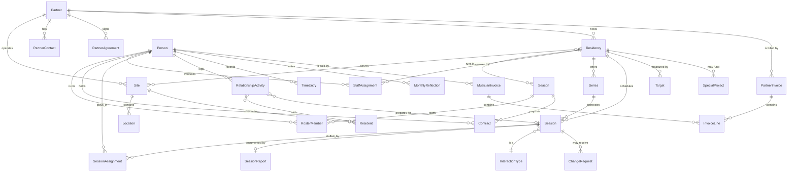

# Iris App — Domain Model (Language 1: the code)

_Draft v0.3, November 21, 2026 (v0.3: decisions D1, D3 and D5 settled, including how a month's schedule is reviewed, published and sent; v0.2: `Person` rules confirmed and built; see section 7). This is the **authoritative** definition of the
app's objects. GLOSSARY.md translates the team's language (Language 2) and
our partner-facing language (Language 3) into these objects._

## The three languages

| | Language | Who uses it | Can it change? | Rule |
|---|---|---|---|---|
| **1** | **Domain model** (this file) | The code, the database, developers | Yes: we design it | One name, one meaning. No overloading, ever. |
| **2** | **Team language** | Iris staff and musicians, day to day | No: it is set | The app's screens may *display* team words, but every team word must map to exactly one object **in context** (GLOSSARY Part A). |
| **3** | **Outward language** | Partners, residents, funders: calendars, invoices, reports | No: it is set | Generated documents use partner-facing words and names. Templates map each printed field to an object attribute (GLOSSARY Part B). |

**Rules for Language 1**
1. **The word "program" is never used as an identifier** in code, database
   tables, columns or APIs. It is a display word only (Languages 2 and 3).
   Likewise "community" and "residency" (except `Residency`, defined
   below with one meaning) are not used loosely.
2. Every object below has one definition. If a new concept doesn't fit an
   existing definition, it becomes a new object. We don't stretch an old one.
3. Lists that people edit (types, categories) are **data**, not code, and are
   **versioned**: values are retired, never deleted, so old records keep their
   meaning.
4. Where a decision in TERMINOLOGY-REVIEW.md is still open, the model takes a
   default, marked **Assumption (D#)**. Changing an assumption changes this
   file first.

---

## Object map

---

## 1. Partners and places

### `Partner`
The organization Iris contracts with and bills (e.g. Charles E. Smith Life
Communities; Comprehensive Housing Assistance; Mather; Winter Growth; Asbury
Methodist Village). Also covers non-senior-living partners (a community
center, a 50+ center).

| Attribute | Type | Notes |
|---|---|---|
| `legal_name` | text | As on contracts and invoices |
| `display_name` | text | As printed on calendars (Language 3) |
| `billing_address`, `billing_email` | text | For `PartnerInvoice` |
| `active` | bool | |

### `Site`
A building or campus where programming happens (e.g. Ring House, Weinberg
Manors, Mather Tysons, Winter Growth Olney). Belongs to exactly one `Partner`.

| Attribute | Type | Notes |
|---|---|---|
| `partner_id` | → Partner | Required |
| `name`, `display_name` | text | |
| `care_levels` | set of enum | `independent`, `assisted`, `memory_care`, `skilled_nursing`, `adult_day`, `affordable_housing`, `other` |
| `address`, `city`, `state`, `timezone` | text | Timezone matters: sites span ET, CT and MST (Tucson) |
| `active` | bool | |

### `Location`
A specific room, unit or floor within a `Site` (an auditorium, a named
building on a campus, a unit). Belongs to exactly one `Site`.

| Attribute | Type | Notes |
|---|---|---|
| `site_id` | → Site | Required |
| `name`, `display_name` | text | |
| `active` | bool | |

### `PartnerContact`
A person at a partner who receives calendars or invoices. Does **not** sign in.

| Attribute | Type | Notes |
|---|---|---|
| `partner_id` | → Partner | |
| `site_ids` | → Site (many) | Which sites they cover; empty = all |
| `name`, `title`, `email`, `phone` | text | |
| `receives` | set of enum | `calendar`, `invoice` |

### `Resident`
An older adult at a `Site` with whom musicians build relationships. Minimal
by design. **Never** holds health information.

| Attribute | Type | Notes |
|---|---|---|
| `site_id` | → Site | Required. A resident belongs to one site |
| `display_name` | text | As musicians know them, e.g. first name + last initial |
| `disambiguator` | text | Optional short note to tell residents with the same name apart (e.g. unit or "violin student"). **No health details** |
| `active` | bool | Deactivate when a resident moves or passes away; never delete (history) |

**Invariant:** `display_name` + `disambiguator` is unique within a `Site`.
**Assumption (D14, Q1):** residents are recorded by name, visible only to
musicians on that site's roster and to admins.

---

## 2. Residencies, seasons and people

### `Residency`
**Iris's ongoing engagement with one Partner at one or more of its Sites,
delivered by a roster of musicians.** This is what the team calls "the
program at Mather" (Language 2) and what the workbooks call an "Iris Ensemble
Program". The code uses `Residency` because the team no longer uses that word
day to day, so it carries exactly one meaning here, and it names the
Ensemble-in-Residence model. **Decided (D1, Nov 21, 2026):** the code name
is `Residency`; screens and documents still say "program".

| Attribute | Type | Notes |
|---|---|---|
| `partner_id` | → Partner | Required, exactly one |
| `site_ids` | → Site (many, ≥1) | All must belong to `partner_id` |
| `name` | text | Internal, e.g. "Mather Evanston/Wilmette" |
| `display_name` | text | For outward documents, e.g. "Iris Music Project at Ring House" |
| `status` | enum | `planned`, `active`, `paused`, `ended` |
| `started_on`, `ended_on` | date | |

**Invariants:** a `Residency` belongs to one `Partner`. Each `Site` may host
several residencies over time, but they don't overlap within the same
`Season` dates unless an admin allows it.

### `Season`
A dated period of a `Residency` during which a roster, contracts, targets
and stipend installments apply (e.g. "Asbury Feb–May 2027", "Weinberg Manors
Fall 2026").

| Attribute | Type | Notes |
|---|---|---|
| `residency_id` | → Residency | |
| `name` | text | |
| `starts_on`, `ends_on` | date | |
| `kind` | enum | `semester`, `season`, `summer_session`, `other` |

**Assumption (D8):** a semester is a `Season` with `kind = semester`;
"twice per semester" stipends and per-semester targets attach to `Season`.

### `Person`
Anyone who signs in: musicians, staff, volunteers. One record per human.

| Attribute | Type | Notes |
|---|---|---|
| `name`, `email` (login), `phone` | text | Email is the sign-in identity (Supabase) |
| `employment_type` | enum | `contractor_1099`, `employee_w2`, `volunteer` |
| `instruments` | set of text | |
| `system_roles` | set of enum | `admin` (see section 7): the Iris core (salaried) team, who get the admin view across every residency (D5). Empty for most musicians |
| `job_title` | text | Org-chart title, e.g. "Director of Programs", "Musician in Residence 1". **Display only. Grants no permissions** |
| `active` | bool | Deactivated people keep history and cannot sign in |
| `certified_on` | date | Creative Aging Practitioner certification, if completed |

**Rules (confirmed by Ryan, Nov 21, 2026; built in `supabase/migrations`):**
- People are **deactivated, never deleted**. Deactivating blocks sign-in and hides all data from that person at once (R9.5).
- A person may change only their own `phone` and `instruments`. Everything else is admin-only.
- `email` can't be changed in the app: it's the sign-in identity.
- An admin can't remove their own `admin` role or deactivate themselves, so Iris can't be locked out by accident.

### `RosterMember`
A `Person`'s membership on a `Residency` for one `Season`.

| Attribute | Type | Notes |
|---|---|---|
| `season_id` | → Season | |
| `person_id` | → Person | |
| `is_core` | bool | Part of the core ensemble vs. occasional/substitute pool (D16) |
| `is_admin_lead` | bool | The handbook's "administrative project lead". **At most one per Season**, covering all of the residency's sites (D5) |
| `joined_on`, `left_on` | date | |

### `StaffAssignment`
An Iris staff member responsible for a `Residency` (the handbook's
"designated Iris staff member"; the team says "point person").

| Attribute | Type | Notes |
|---|---|---|
| `residency_id` | → Residency | |
| `person_id` | → Person | Must have `system_roles ∋ admin` or be explicitly granted |
| `role` | enum | `point_person` (approves), `support` (view only) |
| `starts_on`, `ends_on` | date | Effective dating keeps history through org changes (2028, 2029) |

**Invariant:** each active `Residency` has exactly one current
`point_person`.

### `Contract`
The agreement under which Iris pays a contractor for one `Season` of one
`Residency`.

| Attribute | Type | Notes |
|---|---|---|
| `person_id`, `season_id` | → | Unique together |
| `hourly_rate` | money | Flat rate, prep time included |
| `estimated_weekly_hours` | number | |
| `stipends` | list of `{kind, amount, installments: [{due_on, amount}]}` | `kind`: `project_support`, `admin_lead`, `training`, `other` |
| `signed_on` | date | |
| `status` | enum | `draft`, `sent`, `signed`, `ended` |

W-2 employees have no `Contract`. They are paid through payroll.

---

## 3. Scheduling

### `InteractionType`
The admin-managed, versioned list of kinds of session (Language 2 examples:
Open Rehearsal, Performance, Lecture/Discussion, Music Instructional
Program, Interdisciplinary Program, Special Event).

| Attribute | Type | Notes |
|---|---|---|
| `name` | text | |
| `model_type` | enum `ModelType` | `performance`, `small_group`, `one_to_one`. Maps to the JAAH model's three types |
| `default_time_category` | → TimeCategory | Used to pre-fill time entries |
| `active` | bool | Retired, never deleted |
| `description` | text | Shown to musicians as guidance |

### `Series`
**A titled, recurring offering within a `Residency`** (Language 2: "the
Music Café program", "Tuesday open rehearsals"). A `Series` is a template;
it doesn't happen. Its `Session`s happen.

| Attribute | Type | Notes |
|---|---|---|
| `residency_id` | → Residency | |
| `title` | text | **Title only.** Never personnel or location (D12) |
| `interaction_type_id` | → InteractionType | |
| `default_location_id` | → Location | Must be at one of the residency's sites |
| `recurrence` | rule | e.g. weekly on Wednesdays 11:00, 120 minutes |
| `default_personnel` | → Person (many) | Must be on the current roster |
| `active_from`, `active_until` | date | |

### `Session`
**One scheduled occurrence on a specific date and time.** The unit of
scheduling, partner calendars, documentation and partner billing. A session
either comes from a `Series` or stands alone (a special event, a concert,
an extra program).

| Attribute | Type | Notes |
|---|---|---|
| `residency_id` | → Residency | Required |
| `series_id` | → Series | Optional. Null = one-time session |
| `title` | text | Copied from the series and editable per session |
| `interaction_type_id` | → InteractionType | Copied from the series and editable |
| `location_id` | → Location | |
| `starts_at` | datetime (site timezone) | |
| `scheduled_minutes` | int | |
| `call_time` | time | Optional (concerts) |
| `is_special_event` | bool | Shown in the "Special events" section of partner calendars |
| `is_extra` | bool | Outside contracted hours; separately negotiated pay (D10) |
| `special_project_id` | → SpecialProject | Optional |
| `planned_resident_involvement` | enum `ResidentInvolvement` | `none`, `co_facilitated`, `co_led` (D6) |
| `schedule_state` | enum | `draft`, `published`, `canceled` |
| `cancellation_reason` | enum | `partner`, `weather`, `musician`, `other`. Required if canceled |
| `public_note` | text | May print on partner calendars |
| `internal_note` | text | Never prints |

**Invariants**
- `location.site` ∈ `residency.sites`.
- A non-canceled session has **exactly one** `SessionAssignment` with
  `role = leader`.
- Once `published`, only admins, the point person and the Admin Lead can
  edit it. Every edit is logged in `AuditLog`, and the session's musicians
  are notified. Others submit a `ChangeRequest`. (D5)
- A canceled session stays in the record. Pay and billing treatment follow
  `cancellation_reason` (handbook: canceled sessions are not paid).

### `SessionAssignment`
A `Person` assigned to play in a `Session`.

| Attribute | Type | Notes |
|---|---|---|
| `session_id`, `person_id` | → | Unique together |
| `role` | enum | `leader`, `participant` |
| `status` | enum | `assigned`, `absent`, `substitute` |
| `substitute_for_id` | → Person | Required when `status = substitute` |

The program leader is **per session** and is expected to rotate among
participating musicians (handbook). The app can report rotation balance.

### `ChangeRequest`
A request to change a published `Session`.

| Attribute | Type | Notes |
|---|---|---|
| `session_id`, `requested_by` | → | |
| `proposed_changes` | structured | Any of title, time, location, personnel, cancellation |
| `reason` | text | |
| `status` | enum | `open`, `approved`, `declined` |
| `decided_by`, `decided_at` | | |

### `Closure`
Dates when sessions don't run (Iris holidays, partner closures, blackout
dates).

| Attribute | Type | Notes |
|---|---|---|
| `scope` | enum + id | `all_iris`, `partner`, `site`, `residency`, `person` (a musician's blackout dates) |
| `starts_on`, `ends_on` | date | |
| `reason` | text | |

### `CalendarExport`
One version of a monthly partner calendar for one site (Language 3
document). A month can have several versions as the partner gives feedback.

| Attribute | Type | Notes |
|---|---|---|
| `residency_id`, `site_id` | → | |
| `month` | year-month | |
| `version` | int | 1, 2, 3… per residency × site × month. Unique together |
| `state` | enum | `reviewed` (version 1 only: reviewed, not yet published), `sent` |
| `reviewed_by`, `reviewed_at` | → Person, datetime | Version 1 only: the point person (or an admin) after reviewing the draft with the Admin Lead |
| `format` | enum | `pdf`, `docx` |
| `generated_at`, `generated_by` | | Who clicked "Publish and download" (version 1) or "Download updated calendar" (later versions) |
| `sent_at` | datetime | Set when generated. The Admin Lead emails the file from their own email, cc'ing the point person; the app doesn't send it |
| `partner_feedback` | text | Optional. A summary of the partner's reply that led to the next version. **Internal: never prints** |
| `file` | storage ref | |

Built only from `published` sessions.

**Publishing a month (decided, D5, Nov 21, 2026)**
1. The Admin Lead drafts the month's sessions for a site (`schedule_state = draft`).
2. The point person reviews the draft with the Admin Lead (often on a call)
   and marks it reviewed. This creates version 1 with `state = reviewed`.
3. The Admin Lead clicks **Publish and download**. All of that site's draft
   sessions for the month become `published`, the PDF is generated, and
   version 1 becomes `sent`. **Musicians treat the schedule as final from
   here.** Version 1 can't be generated before step 2.
4. The Admin Lead emails the PDF to the partner from their own email, with
   the point person cc'd.
5. If the partner sends feedback, the Admin Lead edits the published
   sessions (each change logged; musicians notified), optionally records
   `partner_feedback`, and clicks **Download updated calendar**, which
   creates the next version with `state = sent`. Later versions don't need
   another review.

---

## 4. Documentation

### `SessionReport`
The documentation of one `Session`, written by its **leader**. **Decided (D3):** other musicians at the session don't document it; each logs their own `RelationshipActivity`, `TimeEntry` and `MonthlyReflection`.

| Attribute | Type | Notes |
|---|---|---|
| `session_id` | → Session | One report per session |
| `author_id` | → Person | The session leader (or an admin) |
| `actual_start`, `actual_end` | datetime | From the in-app timer or entered by hand |
| `resident_attendance` | int | Residents only |
| `other_attendance` | int | Optional: staff, family. **Assumption (D15)** |
| `interaction_type_id` | → InteractionType | What actually happened; defaults to the session's |
| `resident_involvement` | enum `ResidentInvolvement` | What actually happened |
| `notes` | text | No health information |
| `state` | enum | `due`, `submitted`, `approved` |
| `submitted_at`, `approved_by`, `approved_at` | | |

**Invariants:** exists only for sessions that are not canceled and are in
the past. Locked once `approved`; corrections go through an admin and are
logged.

### `RelationshipActivity`
One logged instance of relationship building with one or more residents
(Language 2: "relationship-building activity", formerly "one-to-one").

| Attribute | Type | Notes |
|---|---|---|
| `person_id` | → Person | The musician |
| `residency_id` | → Residency | |
| `occurred_on` | date | |
| `location_id` | → Location | Optional |
| `kind` | enum | `one_to_one`, `mini_group` (2–8 residents), `co_facilitation_prep`, `other` |
| `engagement_type_id` | → EngagementType | Admin-managed list (e.g. conversation, lesson, rehearsal, music for comfort, planning) |
| `minutes` | int | |
| `resident_ids` | → Resident (many, ≥1) | All at the residency's sites |
| `prepares_session_id` | → Session | Optional: planning a co-led session (handbook: ≥5 meetings) |
| `note` | text | One sentence. **No health information** |
| `state` | enum | `submitted`, `approved` |

### `EngagementType`
Admin-managed, versioned list used by `RelationshipActivity.engagement_type_id`.
Attributes: `name`, `description`, `active`.

### `MonthlyReflection`
A musician's monthly narrative for one `Residency`.

| Attribute | Type | Notes |
|---|---|---|
| `person_id`, `residency_id`, `month` | | Unique together |
| `highlights` | text | "What am I most proud of this month?" |
| `challenges` | text | "What were my biggest barriers to success this month?" |
| `state` | enum | `draft`, `submitted` |

---

## 5. Time and pay

### `TimeCategory`
Admin-managed, versioned list of pay categories (Language 2: "Programs",
"Relationship Building", "Concerts"; possibly training/meetings).
Attributes: `name`, `description` (the handbook's definition), `paid_hourly`
(bool), `active`.

### `TimeEntry`
Hours a musician worked in one week, for one `Residency`, in one category.
**This is what pay is calculated from. Decided (D3, option A, Nov 21, 2026):** time entries are pre-filled from documented sessions and activities, and the musician adjusts them.

| Attribute | Type | Notes |
|---|---|---|
| `person_id`, `residency_id` | → | |
| `week_starting` | date (Monday) | |
| `time_category_id` | → TimeCategory | |
| `hours` | decimal | |
| `source` | enum | `prefilled` (from sessions and activities), `manual` |
| `state` | enum | `draft`, `submitted`, `approved` |

**Invariant:** unique per person × residency × week × category. The app
flags a week when submitted hours differ sharply from documented sessions
and activities.

### `PayPeriod`
A two-week, Monday–Sunday period. Attributes: `starts_on`, `ends_on`,
`pay_date`.

### `PayAdjustment`
A one-off payment outside hourly pay and stipends: special pay, an extra
program, a special project fee, a reimbursement.

| Attribute | Type | Notes |
|---|---|---|
| `person_id`, `residency_id` | → | |
| `kind` | enum | `special_pay`, `extra_program`, `special_project`, `reimbursement`, `other` |
| `amount` | money | |
| `session_id` / `special_project_id` | → | Optional link |
| `state` | enum | `proposed`, `approved` |

### `MusicianInvoice`
What Iris pays one contractor for one `PayPeriod` (Language 3: the musician's
invoice to Iris).

| Attribute | Type | Notes |
|---|---|---|
| `person_id`, `pay_period_id` | → | Unique together |
| `lines` | → InvoiceLine (many) | |
| `total` | money | Sum of lines |
| `state` | enum | `draft`, `approved`, `paid` |

**Calculation:** approved `TimeEntry` hours in the period × `Contract.hourly_rate`
(per residency), + stipend installments due in the period, + approved
`PayAdjustment`s. Only `employment_type = contractor_1099`.

### `PartnerAgreement`
What Iris charges a `Partner` for a `Residency` and `Season`.

| Attribute | Type | Notes |
|---|---|---|
| `partner_id`, `residency_id`, `season_id` | → | |
| `billing_basis` | enum | `per_session`, `per_hour`, `flat_monthly`, `flat_season`. **Open (D9)** |
| `rates` | structured | By interaction type or flat |
| `billing_period` | enum | `monthly`, `per_season`, `custom` |
| `bill_canceled` | rule | Per cancellation reason |

### `PartnerInvoice`
What Iris bills a `Partner` for one billing period (Language 3 document).

| Attribute | Type | Notes |
|---|---|---|
| `partner_id`, `period_start`, `period_end` | | |
| `lines` | → InvoiceLine (many) | |
| `total` | money | |
| `state` | enum | `draft`, `sent`, `paid` |

### `InvoiceLine`
One line on either kind of invoice: `description`, `quantity`, `unit`,
`unit_amount`, `amount`, plus a `source` reference (`TimeEntry`, stipend
installment, `PayAdjustment`, or `Session`) so every amount traces back to
its record.

---

## 6. Goals, projects and oversight

### `Target`
A goal set by an admin.

| Attribute | Type | Notes |
|---|---|---|
| `scope` | enum + id | `residency`, `roster_member` (per musician) |
| `season_id` | → Season | |
| `metric` | enum | `avg_resident_attendance` (default 7, handbook), `co_led_sessions_per_musician` (default 2 per semester, handbook), `relationship_minutes_per_week`, `sessions_by_model_type`, `other` |
| `value` | number | |

### `SpecialProject`
A one-time, mission-aligned initiative proposed and funded outside regular
contracted hours (handbook: "Special Projects"). Can link sessions,
activities and pay adjustments. Emergent projects such as a festival are
modeled here. **Assumption (D10)**

| Attribute | Type | Notes |
|---|---|---|
| `residency_id` | → Residency | |
| `title`, `proposal` | text | The one-page proposal |
| `estimated_hours`, `budget` | number, money | |
| `state` | enum | `proposed`, `approved`, `declined`, `complete` |

### `Setting`
Admin-editable rules from the handbook, so compliance is data:
`schedule_internal_due_day` (10), `schedule_partner_due_day` (15),
`documentation_due` (last day of month), `time_entry_due` (weekday + time),
`cancellation_notice_time` (09:00). **Values pending D7.**

### `AuditLog`
Every create, change or approval of schedules, reports, activities, time,
contracts and invoices: `who`, `when`, `object`, `before`, `after`.
Resident-record **reads** are logged too.

---

## 7. Permissions (who can do what)

Permissions come from **relationships**, not job titles.

| Capability | Granted by |
|---|---|
| Everything | `Person.system_roles ∋ admin` |
| Approve a residency's reports, activities and time | Current `StaffAssignment.role = point_person` |
| Edit draft and published sessions; publish a month and download its partner calendar (after review) | `RosterMember.is_admin_lead` (current season); the current point person; admins |
| Mark a month's draft schedule reviewed | Current `StaffAssignment.role = point_person`; admins |
| See a residency's sessions and community info | Any current `RosterMember` |
| See and log residents | Current `RosterMember` at that residency's sites; admins |
| Document a session | That session's leader; admins |
| See own time, invoices, contract | The person |
| See and edit any `Person`; add, deactivate and reactivate people | `Person.system_roles ∋ admin` |
| See own `Person` record; change own `phone` and `instruments` | The person (while `active`) |

---

## 8. What is deliberately **not** an object

- **"Program."** Not an object. Depending on context it is a `Residency`, a
  `Series`, a `Session`, or a `TimeCategory` (GLOSSARY Part A).
- **"Community."** Not an object. A `Partner`, a `Site`, or the people of a
  site.
- **"Ensemble."** Not an object. The core `RosterMember`s of a `Season`.
- **"Workbook" and "timesheet."** These are today's spreadsheets. Their
  contents map to `Session`, `SessionReport`, `RelationshipActivity`,
  `MonthlyReflection` and `TimeEntry`.
- **Ecosystem health.** Not stored. Computed from the objects above (see
  GLOSSARY Part C).
